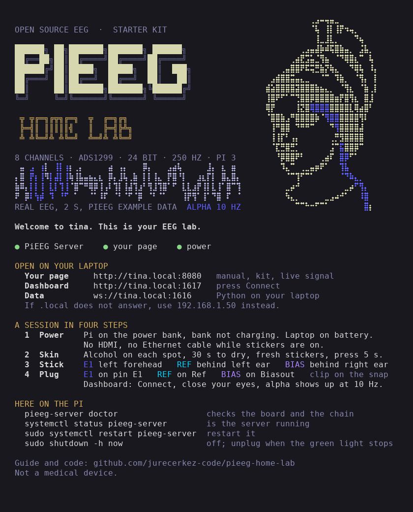

# Deploy

What runs on the Pi besides PiEEG Server: the kit's page on port 8080 (`http://tina.local:8080`) and the welcome shown on every SSH login. Both are plain files, so the copy in this repository is the backup.

| File | Goes to | What it does |
|---|---|---|
| [`../page/`](../page) | `~/tina-eeg/` | the page: manual, spec sheet and live signal in one, served as static files |
| [`tina-page.service`](tina-page.service) | `/etc/systemd/system/` | serves `~/tina-eeg` on port 8080 with Python's built in web server |
| [`update-motd.d/05-welcome`](update-motd.d/05-welcome) | `/etc/update-motd.d/` | the SSH welcome: the lab, live status and power, a session in four steps, a few commands |

On the Pi, from the repository root (the service file assumes the user `jure`; change `User` and the paths for another account):

```bash
mkdir -p ~/tina-eeg && rsync -a --delete page/index.html page/favicon.ico page/assets ~/tina-eeg/
sudo install -m 644 deploy/tina-page.service /etc/systemd/system/
sudo systemctl daemon-reload && sudo systemctl enable --now tina-page

sudo install -m 755 deploy/update-motd.d/05-welcome /etc/update-motd.d/
sudo cp /etc/motd /etc/motd.debian && sudo truncate -s 0 /etc/motd   # Debian's default text, kept as a backup
sudo chmod -x /etc/update-motd.d/10-uname                            # Debian's kernel line, or it prints after the art
```

`rsync --delete` also removes files that a previous copy left behind, so a renamed drawing doesn't linger. `favicon.ico` isn't linked from the page, but browsers ask for it anyway, and this keeps that request from being a 404 in the log.

Check: `curl -s -o /dev/null -w '%{http_code}\n' http://127.0.0.1:8080/` prints `200`, the same URL with `tina.local` works from the laptop, and a new SSH login shows the welcome. To put the Debian login back: `sudo chmod +x /etc/update-motd.d/10-uname && sudo cp /etc/motd.debian /etc/motd && sudo rm /etc/update-motd.d/05-welcome`.

The page's six drawings are rendered by [`page/tools/page_figures.py`](../page/tools/page_figures.py) with the same renderer and parts as the figures in `docs/` (see [`docs/figures/README.md`](../docs/figures/README.md)). Run `python page/tools/page_figures.py` to rebuild them into `page/assets/svg`. It needs the same Python packages as `docs/figures/make_figures.py`, and the forearm and chest drawings also need `docs/figures/data/makehuman_base.obj`, which is not in the repository: `docs/figures/extract_reference_data.py` downloads it once.

## The SSH welcome



`05-welcome` is generated, so edit [`make_welcome.py`](make_welcome.py) and run it again:

```bash
pip install numpy scipy pillow pyfiglet pyte
python deploy/make_welcome.py --preview     # writes 05-welcome and welcome-preview.png
```

The art is fixed when it is built: the bust from `docs/images/hero.png` as a braille line drawing, the title, and the 2 s with the most alpha from the hero's real recording. Service status and power are read on every login; if the Pi reports under-voltage, the welcome says so in red. It uses 256 colors and fits 80 columns, so it looks the same in any terminal whose font has braille, which current ones on macOS, Windows and Linux do.
