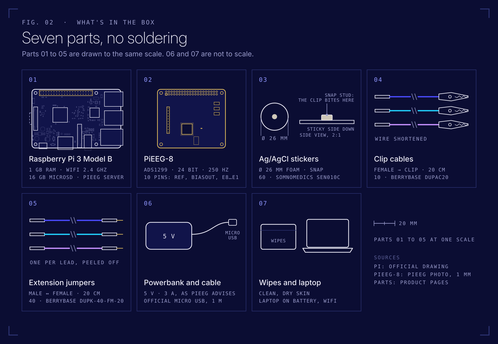
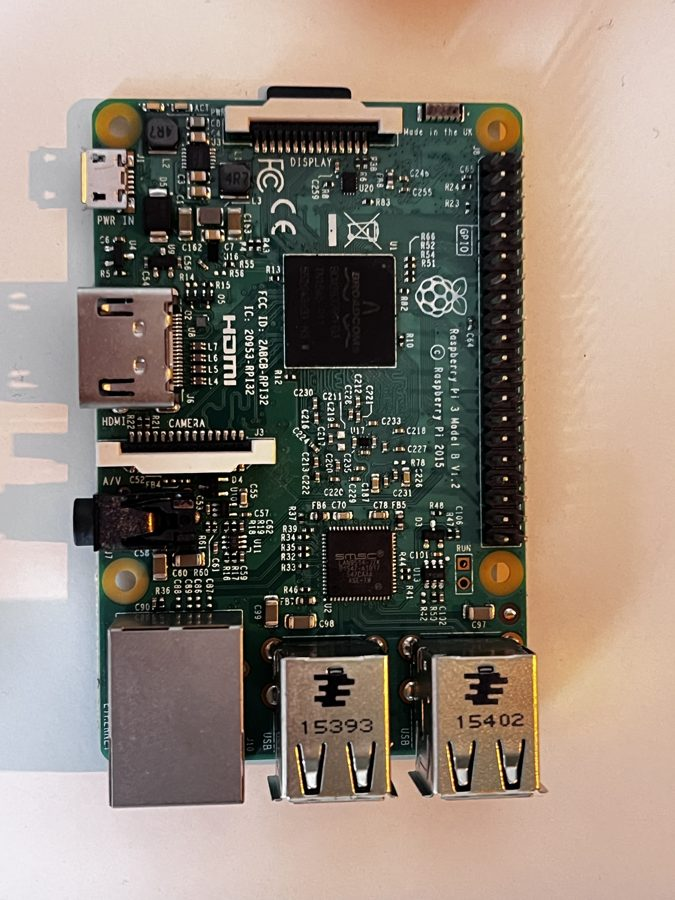
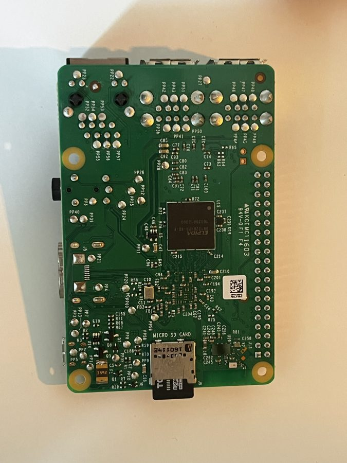

# Equipment

Every part in the box, what it is, why it's there, and how it connects.

---

## ① Raspberry Pi 3 Model B

 

| | |
|---|---|
| Board | Raspberry Pi 3 Model B, revision V1.2, launched in 2016 (the board prints © 2015) |
| CPU / RAM | Broadcom BCM2837, 4 × 1.2 GHz, 1 GB |
| WiFi | 2.4 GHz only |
| Power | 5 V via Micro USB (**PWR IN**). Raspberry Pi specifies a 2.5 A supply |
| Storage | 16 GB MicroSD with Raspberry Pi OS Lite and PiEEG Server |
| Role | Talks to the EEG chip over SPI, runs PiEEG Server, streams data over WiFi |

The 40 pin header on the right edge of the top photo is where the PiEEG-8 sits. Pin 1 is the corner pin closest to the MicroSD side.

---

## ② PiEEG-8 board

 

Photos: PiEEG, from the [official documentation](https://docs.pieeg.com/hardware/devices/pieeg-8/).

| | |
|---|---|
| Converter | Texas Instruments **ADS1299**, the same chip as OpenBCI Cyton and many research amplifiers |
| Resolution | 24 bit, simultaneous sampling on all channels |
| Sample rate | 250 samples/s (default) |
| Inputs | 8 channels + Reference + Bias, on a 10 pin 2.54 mm **male** header |
| Gain | Programmable 1, 2, 4, 6, 8, 12, 24 |
| Noise | 0.4 µV internal and 0.8 µV external in PiEEG's paper ([arXiv:2201.02228](https://arxiv.org/abs/2201.02228), Table 1). The paper doesn't say whether RMS or peak to peak, nor the bandwidth. Your board's real number: `self_test.py` |
| Link to Pi | SPI0 (pins 19, 21, 23, 24) + DRDY on GPIO 26 (pin 37) |
| Bought at | [Elecrow](https://www.elecrow.com/pieeg.html) |

**What it does:** your brain produces voltages of a few to a few tens of microvolts at the scalp. The ADS1299 amplifies each electrode against the reference, converts it to a 24 bit number 250 times per second, and tells the Pi "new sample ready" by pulling DRDY low. The Bias output holds your body at a fixed voltage from the chip, so every electrode stays inside the converter's input range and the body doesn't float.

**Electrode header** (left edge of the board, printed as `1-8 Elec`):

Image: PiEEG. Electrode header on the left, LED that lights up when the board has power.

From top to bottom: **Ref, Biasout, E8, E7, E6, E5, E4, E3, E2, E1**. Always check against the print on your own board.

**Ref** is the shared reference for all 8 channels (the ADS1299's SRB1 input). **Biasout** holds the body at the chip's mid supply voltage so the inputs stay in range. With PiEEG's register settings it is a fixed voltage, not a feedback loop that cancels 50 Hz hum ([details](safety.md#what-the-bias-electrode-does), [how it works](how-it-works.md#reference-and-bias)). PiEEG's official setup uses ear clips on the earlobes for these two. This kit uses stickers on the mastoids behind the ears instead.

---

## ③ Electrode stickers (Ag/AgCl, foam, 2.6 cm)

| | |
|---|---|
| Type | Self adhesive, single use, silver / silver chloride sensor |
| Size | 2.6 cm diameter foam, metal snap button in the middle |
| Use | Skin without hair: forehead (Fp1, Fp2), behind the ears (mastoids) |
| Amount | 2 packs × 30 = 60 stickers, about 15 sessions with 4 stickers each |
| Bought at | [Somnomedics, SEN010C](https://shop.somnomedics.de/en/Single-adhesive-electrode-Ag-AgCl-foam-2.6-cm-OE/SEN010C) |

**Why Ag/AgCl:** silver chloride is the standard for biosignal electrodes because it gives a stable, low noise contact with the skin. **Why stickers:** no gel in the hair, and they hold still. **Limit:** they don't work through hair, so channels over the scalp need dry comb electrodes later ([Mission 4](missions.md#mission-4-more-channels-on-bare-skin)).

---

## ④ Dupont to alligator clip cables (20 cm)

| | |
|---|---|
| Ends | Female Dupont (fits the board's male pins) ↔ alligator clip (bites the sticker snap) |
| Length | 20 cm |
| Amount | 10, one for every pin on the electrode header |
| Bought at | [BerryBase, DUPAC20](https://www.berrybase.de/en/10pin-jumper/dupont-kabel-female-krokodilklemme-trennbar-20cm?c=338) |

The 10 wires come as a ribbon you can peel apart. Short wires are good for EEG: less antenna, less hum, fewer motion spikes. But 20 cm alone is not enough: measured on an adult head and shoulders model, the longest path in the start montage (Pi on a shelf at shoulder height, Bias behind the right ear) is 33 cm. One extension jumper per lead fixes that, see ⑤.

> If your board ever turns out to have a socket instead of pins, you need the male version (BerryBase DUPAD20).

---

## ⑤ Dupont extension jumpers (20 cm and 50 cm)

| | |
|---|---|
| Ends | Female Dupont (onto the board's pin) ↔ male Dupont (into the clip cable's female end) |
| Length | 20 cm or 50 cm. Together with the clip cable that is about 40 cm or 70 cm of lead per electrode |
| Amount | One ribbon of 40 in each length. 3 in use for the start montage, the rest are spares |
| Bought at | BerryBase [DUPK-40-FM-20](https://www.berrybase.de/en/40pin-jumper-dupont-cable-male-female-separable/length-0-20-m) and [DUPK-40-FM-50](https://www.berrybase.de/en/40pin-jumper-dupont-cable-male-female-separable/length-0-50-m) |

**Which length.** Take 20 cm when the board can sit on a shelf beside the head: that is the
shortest lead that reaches, and short wire is the quieter wire. Take 50 cm when the board has
to be further away, behind the head or on a desk. Both fit the same pins.

**Why they exist.** The 20 cm clip cables can't reach Fp1, Ref and Bias from any single board position on an adult head: the three sites span half the head. With one jumper per lead, a shelf at shoulder height and a pillow beside the head both work (README, step 4).

**What they cost you in signal.** Longer unshielded wire picks up more 50 Hz hum, and moving cables make motion artifacts, which matters in the microvolt range. Keep the three leads loosely together, away from mains leads, chargers and monitors, and keep still while recording. Push each joint fully home: a loose joint shows up as spikes or a flat channel.

---

## ⑥ Powerbank and Micro USB cable

| | |
|---|---|
| Powerbank | 5 V USB A powerbank. PiEEG asks for a **3 A** powerbank, Raspberry Pi specifies 2.5 A for the Pi 3. Check the label of the port you use |
| Cable | Official Raspberry Pi Micro USB cable, 1 m ([BerryBase RPI-MUSB-1](https://www.berrybase.de/offizielles-raspberry-pi-micro-usb-kabel-rot-1-0m)) |
| Why | The board has no electrical isolation. A battery is the only safe power source with electrodes on, and it also gives a cleaner signal |

A 10,000 mAh powerbank runs the Pi for several hours. Charge it **before** a session, never while it powers the Pi with electrodes on ([safety](safety.md)).

---

## ⑦ Alcohol wipes

Wipe each spot before sticking an electrode and let it dry. Removes skin oil, lowers contact impedance, cleaner signal.

---

## Not in the box, but needed

- **Laptop** (Mac or Windows), on battery while recording, same WiFi as the Pi
- **2.4 GHz WiFi**: the Pi 3 can't see 5 GHz networks

## Official references

| | |
|---|---|
| PiEEG-8 docs | [docs.pieeg.com/hardware/devices/pieeg-8](https://docs.pieeg.com/hardware/devices/pieeg-8/) |
| What's in the box (official) | [required equipment](https://docs.pieeg.com/hardware/devices/pieeg-8/required-equipment/) |
| Electrodes & pinout | [connections](https://docs.pieeg.com/hardware/devices/pieeg-8/connections/) |
| Specification and data frame | [specification](https://docs.pieeg.com/hardware/devices/pieeg-8/specification/) |
| Quick start manual (PDF) | [PiEEG-8 on GitHub](https://github.com/pieeg-club/PiEEG-8/blob/main/Manual.%20Conenction%20and%20start%20-%20PiEEG1.pdf) |
| ADS1299 datasheet | [ti.com/lit/ds/symlink/ads1299.pdf](https://www.ti.com/lit/ds/symlink/ads1299.pdf) |
| Research paper | Rakhmatulin et al., [arXiv:2201.02228](https://arxiv.org/abs/2201.02228) |
