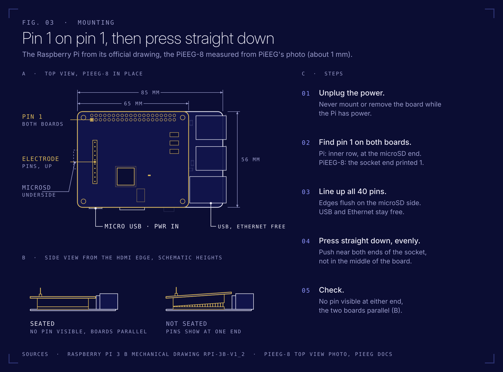
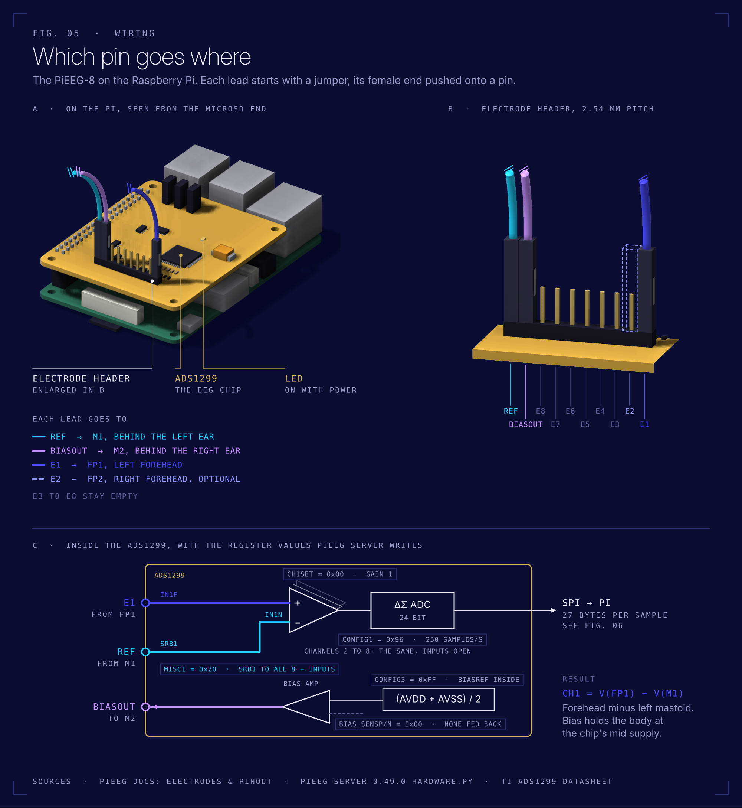
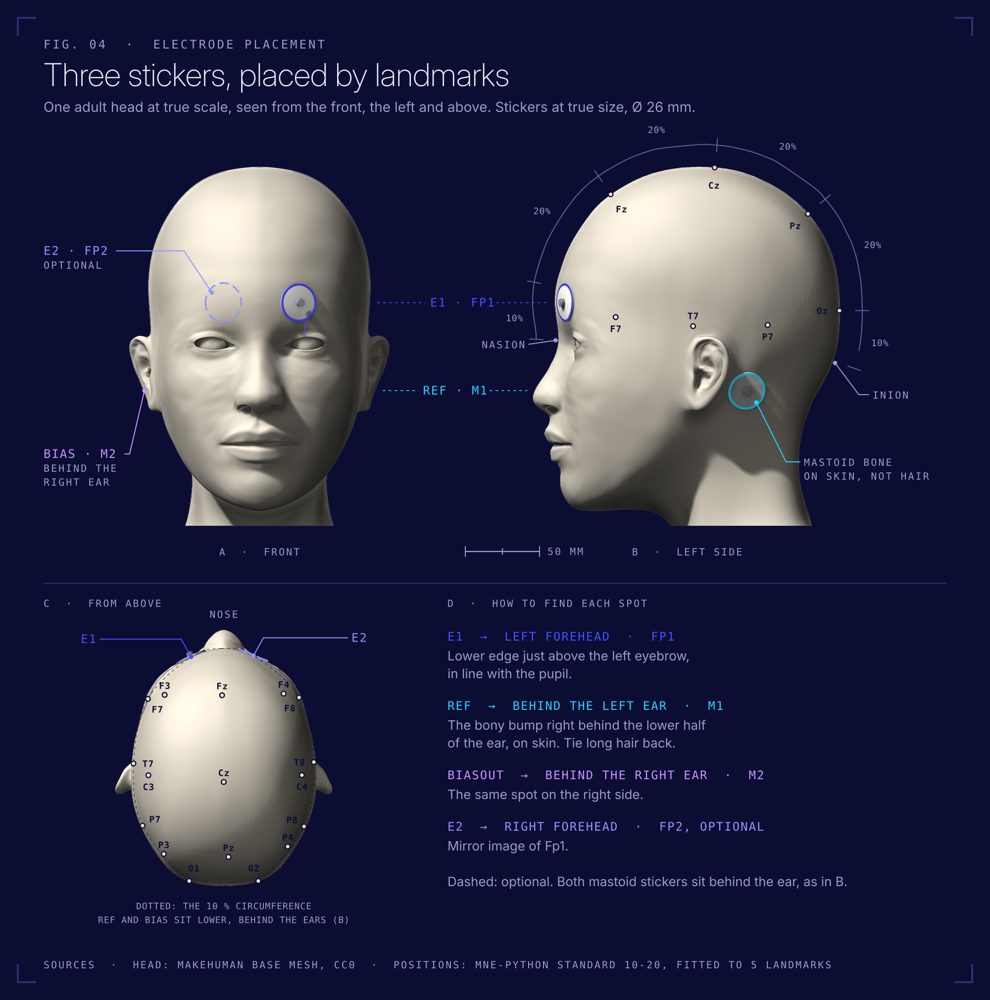

# First test

Goal: see a blink and your alpha rhythm in the browser. "You" is whoever wears the electrodes. With a pacemaker or other implant, don't wear them without a physician's approval: be the researcher and [record someone else](recording-someone-else.md). About 10 minutes. Based on the official [PiEEG-8 How to Start](https://docs.pieeg.com/hardware/devices/pieeg-8/setup/), adapted to the stick on electrodes in this kit.

## You need

- Raspberry Pi 3 Model B with the PiEEG-8 on top and the MicroSD inside
- 3 electrode stickers, 3 alligator clip cables, 3 extension jumpers (peeled off the male to female ribbon)
- Powerbank, **charged and not plugged into the wall**, and the Micro USB cable
- Laptop on battery, **charger unplugged**, on the same WiFi as the Pi
- An alcohol wipe

Power goes in last and comes out first ([connection order](safety.md#connection-order)).

## 1. Check the board

Pi unplugged. The PiEEG-8 sits on all 40 pins of the Pi's GPIO header, pushed down evenly, no pins visible at either end. Never put it on or take it off while the Pi has power. Hold it by the edges.



## 2. Cables on the board



Each lead is an extension jumper plus a clip cable. The jumper's female end slides onto a pin of the 10 pin header, the clip cable's black female end onto the jumper's male end. Push each joint fully home.

The cable is heavier than the sticker, so let the skin carry almost none of it: make a small loop of cable right at the sticker and tape that loop down a few centimetres away. Then a long lead pulls on the tape instead of peeling the sticker, and the wire stops swinging into the signal.

| Lead | Pin |
|---|---|
| 1 | **E1** |
| 2 | **Ref** |
| 3 | **Biasout** |

## 3. Electrodes



1. Tie long hair back. Wipe the left forehead and the bony bump behind both ears. Let it dry for 30 seconds.
2. Stick one electrode on the **left forehead** (Fp1): lower edge just above the left eyebrow, centered over the pupil.
3. Stick one on the **bony bump behind the left ear** and one **behind the right ear** (mastoids, M1 and M2). Skin, not hair.
4. Press each sticker for 5 seconds.
5. Clip the alligator clips onto the metal snaps:

| Sticker | Clip from pin |
|---|---|
| Left forehead | **E1** |
| Behind left ear | **Ref** |
| Behind right ear | **Biasout** |

The clip bites the metal snap in the middle of the sticker, not the foam. Ref and Bias matter most: if one of them is loose, every channel gets noisy.

**Why behind the ears and not on the earlobes?** The official PiEEG setup uses ear clips on the earlobes for Ref and Bias. A 2.6 cm sticker doesn't fit an earlobe, and the mastoid bone right behind it is the other standard reference site in EEG (M1, M2). Same job, better grip.

## 4. Where to put the Pi

Each lead is about 40 cm: jumper plus clip cable. Both positions below reach all three stickers with slack to spare (paths measured on an adult head and shoulders model):

- **Sitting:** Pi and powerbank on a shelf or a stack of books at shoulder height, just beside your left shoulder, on a wooden or plastic surface. Paths: 28 cm to Fp1, 20 cm to Ref, 33 cm to Bias
- **Lying down:** Pi on the pillow beside your left ear. Best position for relaxed alpha. Paths: 19 cm to Fp1, 9 cm to Ref, 23 cm to Bias, which runs around the front of the neck because it can't pass under your head
- Not behind your head: Fp1 is about 45 cm away from there
- Cables hang loose, nothing pulls on a sticker. If one does, move the Pi closer or chain a second jumper onto that lead

**Keep the leads tidy.** Longer unshielded wire picks up more 50 Hz hum, and moving cables make motion artifacts. Keep the three leads loosely together, away from mains leads, chargers and monitors. If the signal is hummy, check this first.

## 5. Power

1. Plug the Micro USB cable into the Pi (port **PWR IN**) and into the powerbank.
2. The red LED on the Pi and the LED on the PiEEG-8 light up. Wait about 60 seconds for the Pi to boot and join the WiFi.

## 6. Setup check (optional, 10 seconds)

```bash
cd pieeg-home-lab/code && source .venv/bin/activate
python check_setup.py --noise-test
```

Every line `[ok]` means WiFi, Pi, server and board work together. The noise part is PiEEG's official check: the chip shorts its own inputs, and every channel under 5 µV RMS means the board is healthy, whatever the stickers are doing. While it runs, every program reading the stream gets that shorted signal, so never run it during a recording. If a line fails, it names the problem, see [troubleshooting](troubleshooting.md).

## 7. Open the dashboard

1. On the laptop open **http://tina.local:1617** in Safari or Chrome and click **Connect**.
2. Check that the dashboard shows **8 channels**. Sixteen means the server isn't in PiEEG-8 mode, see [troubleshooting](troubleshooting.md#pieeg-server).
3. **Bandpass**: already on. PiEEG Server starts with a 1 to 40 Hz bandpass, and the button shows that range. Leave it. Careful: inside the Bandpass menu, the button labelled **Enabled** shows the current state, and clicking it switches the filter off.
4. **Notch**: open it, set **Freq** to **50**, then click **Disabled** so it turns into **Enabled**. The dashboard starts at 60 Hz (USA). Germany runs at 50 Hz.

These filters run on the Pi and change the data for every program that reads the stream, not just the dashboard. That's why `record.py` switches them off while it records and back on afterwards ([how it works](how-it-works.md#filters-on-the-server)).

Doesn't load? See [troubleshooting](troubleshooting.md#the-dashboard-does-not-open).

## 8. What good looks like

Sit still, relax your jaw, look at one point. Watch channel 1.

| Do this | You should see on channel 1 |
|---|---|
| Sit still, eyes open | A small, restless line |
| Blink hard | A big slow spike, several times taller than the resting line |
| Look left, then right | Slow steps up and down: eye movement (EOG) |
| Clench your jaw | A burst of fast, fuzzy noise: muscle (EMG), not brain |
| Close your eyes, relax 20 to 30 s | A rounder rhythm around 10 Hz, a bump at 8 to 13 Hz in the spectrum |

Channels 2 to 8 have nothing connected and look like noise. That's normal.

> Alpha is strongest at the back of the head (O1, O2), where this kit has no electrode. On the forehead it's weaker, so give it time and watch the spectrum. Blinks, eye movements and jaw clenches are your first proof that the system records real biosignals.

**About the µV numbers.** Textbook sizes at the forehead are tens of µV for the background EEG and around 100 µV or more for a blink. The dashboard's µV come from PiEEG's conversion formula, which, read against the ADS1299 datasheet, gives half the true value (0.268 instead of 0.536 µV per count at gain 1, see the note in the [README](../README.md#step-7--check-the-signal) and [Mission 5](missions.md#mission-5-read-the-datasheet)). So a blink that is really 150 µV shows as about 75. Shapes, timing, frequencies and comparisons between recordings don't depend on it.

## 9. Done for today

1. Unplug the powerbank.
2. Unclip, peel off the stickers and throw them away. They're single use.
3. Recharge the powerbank (with nothing connected to the Pi).

Next: record yourself with `code/record.py` and start [Mission 1](missions.md).
