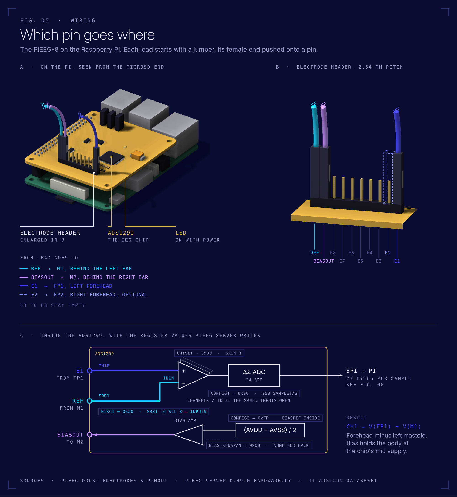
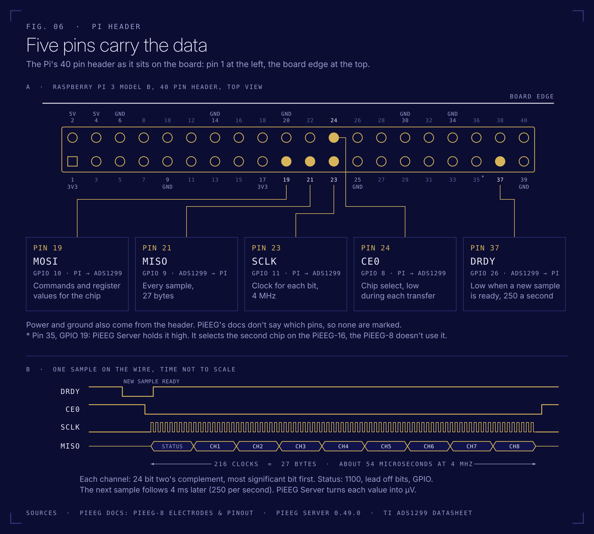

# How it works

From a voltage on your forehead to a number in Python.

## Signal chain

```
 scalp ── Ag/AgCl sticker ── alligator cable ──► PiEEG-8 ─────────────────────► Raspberry Pi 3 ──── WiFi ────► laptop 
 (~10 µV)                     40 cm              ADS1299                SPI0      PiEEG Server                  Python / browser
                                                 · subtracts Ref                  · reads 27 bytes per sample    · live_view.py
                                                 · gain                           · converts to µV               · record.py
                                                 · 24 bit ADC @ 250 Hz            · JSON over WebSocket :1616    · dashboard :1617
                                                 · drives Bias                    · dashboard on :1617
                                                                                  · filters: bandpass on by default
```



<sub>This kit uses electrode stickers: one on the forehead (E1), Ref and Bias behind the ears. The official PiEEG wiring is the same, with a cap and ear clips instead.</sub>

## Reference and bias

Every channel measures the **difference** between its electrode and **Ref**. If Ref is noisy, every channel is noisy, so Ref and Bias stickers matter most.

**Bias** is driven by an amplifier in the ADS1299 and connects the body to a fixed voltage, the middle of the chip's analog supply. That keeps the body, and with it every electrode, inside the converter's input range. In many EEG amplifiers the bias electrode does more: it feeds the common noise of the channels back into the body, inverted, which is what actively cancels 50 Hz hum (PiEEG describes it that way in [Electrodes & Pinout](https://docs.pieeg.com/hardware/devices/pieeg-8/connections/)). PiEEG Server's register setup doesn't use that loop: `BIAS_SENSP` and `BIAS_SENSN` are `0x00`, so no channel feeds the bias amplifier and it holds a fixed voltage. Hum is still smaller with Bias connected than without, because the body no longer floats, but the real hum reduction in this kit comes from battery power and short leads ([safety](safety.md#what-the-bias-electrode-does) has the register details, and the Mission 5 bonus asks what `0xFF` would change). **Ref** is the ADS1299's SRB1 input, shared by all channels (`MISC1 = 0x20`).

## Filters on the server

PiEEG Server can filter the stream before sending it: a bandpass (Butterworth, order 5) and a notch (IIR, Q = 30). Three facts matter, all from the [server source](https://github.com/pieeg-club/PiEEG-server/blob/9bf350310bb492e1373edfe5b0714857f1fe04e9/pieeg_server/server.py) at the version this kit installs:

1. **The 1 to 40 Hz bandpass is on from the start.** The notch is off.
2. **The filters apply to every client.** The dashboard's Bandpass and Notch buttons change what `live_view.py`, `record.py` and every other program receive.
3. **The filters run live, sample by sample** (causal, like any real time filter). That shifts the phase of the signal and starts with a short transient whenever a filter is switched on.

The server doesn't tell connected clients when a filter changes. A new connection learns the state from the welcome message (`"filter"`, `"notch_filter"`, `"notch_freq"`), but not the bandpass cutoffs.

So `record.py` does this:

| When | What `record.py` does |
|---|---|
| Start | Reads the filter state from the welcome message, switches both filters off, drops the next 0.5 s |
| Every 5 s | Reads a fresh welcome message on a second connection. If another client switched a filter on, it switches it off again and marks the affected samples in the sidecar. Side effect: `journalctl -u pieeg-server` shows a "Client connected" line every 5 s while `record.py` runs, that's this check |
| After a reconnect | Same check as at the start (a restarted server begins with the bandpass on again) |
| End | Switches back on what was on at the start: bandpass 1 to 40 Hz, notch at its frequency |

Raw data is what research needs: you choose and document your own filters later, offline, with zero phase filters like `sosfiltfilt`. `--keep-server-filters` records what the server sends instead, and the sidecar's `data_filtering` field says so. PiEEG Server's own **Record** button in the dashboard also saves unfiltered data, on the Pi.

## Raspberry Pi pins used



<sub>Drawn after PiEEG's [official pinout image](https://raw.githubusercontent.com/pieeg-club/PiEEG-docs/main/public/images/hardware/2026/10/pieeg8_pinout.png) and PiEEG Server 0.49.0.</sub>

| Header pin | GPIO | Signal | Direction |
|---|---|---|---|
| 19 | GPIO 10 | SPI0 MOSI | Pi → ADS1299 |
| 21 | GPIO 9 | SPI0 MISO | ADS1299 → Pi |
| 23 | GPIO 11 | SPI0 SCLK | Pi → ADS1299 |
| 24 | GPIO 8 | SPI0 CE0 | Pi → ADS1299 |
| 37 | GPIO 26 | DRDY, low when a sample is ready | ADS1299 → Pi |

Power and ground come from the header too. Source: [PiEEG pinout](https://docs.pieeg.com/hardware/devices/pieeg-8/connections/#raspberry-pi-pinout).

## One sample on the wire

Each time DRDY goes low (250 times a second), the Pi reads **27 bytes**:

| Bytes | Content |
|---|---|
| 0 to 2 | Status word, normally `0xC0 0x00 0x08` |
| 3 to 5 | Channel 1, 24 bit two's complement |
| ... | ... |
| 24 to 26 | Channel 8 |

PiEEG Server turns each 3 byte value into microvolts and broadcasts JSON. The exact formula and register settings: [PiEEG specification](https://docs.pieeg.com/hardware/devices/pieeg-8/specification/) and [ADS1299 datasheet](https://www.ti.com/lit/ds/symlink/ads1299.pdf). Checking that math is [Mission 5](missions.md#mission-5-read-the-datasheet).

## Data formats in this repo

**Live stream** (`ws://tina.local:1616`), one message per sample:

```json
{ "t": 1766686800.123456, "n": 42, "channels": [12.34, -5.67, 8.90, 0.12, 3.45, -1.0, 2.2, 0.8] }
```

| Field | Meaning |
|---|---|
| `t` | Unix time in seconds, from the Pi's clock |
| `n` | Sample counter of the server, the same for every client. A jump means samples were missed |
| `channels` | µV, channel 1 to 8 |

Before the first sample, each connection gets a welcome message: `{"status": "connected", "sample_rate": 250, "channels": 8, "filter": true, "notch_filter": false, "notch_freq": 60.0, ...}`.

**Recording** (`code/record.py`): `recordings/<YYYYMMDD_HHMMSS>_<subject>_<label>.csv`, written sample by sample while recording

```
t,n,ch1,ch2,ch3,ch4,ch5,ch6,ch7,ch8
1766686800.123456,1042,12.34,-5.67,...
```

plus a sidecar with the same name and `.json` (shortened):

```json
{
  "label": "eyes_closed",
  "subject": "sub-01",
  "notes": "",
  "start_time": "2026-12-25T19:00:00.120+01:00",
  "planned_duration_s": 60,
  "duration_s": 60.0,
  "sample_rate_hz": 250,
  "n_samples": 15000,
  "n_channels": 8,
  "units": "microvolts",
  "montage": "fp1",
  "electrodes": { "ch1": "Fp1, left forehead", "ref": "M1, left mastoid ...", "bias": "M2, right mastoid ..." },
  "data_filtering": "none: record.py kept PiEEG Server's filters off, the file holds the unfiltered signal",
  "server_filters_at_start": { "bandpass": true, "notch": true, "notch_freq": 50.0 },
  "possibly_filtered_samples": [],
  "complete": true,
  "end_reason": "planned number of samples reached",
  "sample_number_gaps": 0,
  "missing_samples": 0,
  "events": [
    { "time": "2026-12-25T19:00:00.000+01:00", "last_n": null, "event": "connected", "detail": "server filters: bandpass on, notch on at 50 Hz" },
    { "time": "2026-12-25T19:00:00.001+01:00", "last_n": null, "event": "server filters switched off", "detail": "they were on" },
    { "time": "2026-12-25T19:01:00.400+01:00", "last_n": 16042, "event": "server filters switched back on", "detail": "..." }
  ]
}
```

| Field | Meaning |
|---|---|
| `complete` | `true` only if every planned sample arrived, without gaps |
| `events` | Every connect, disconnect, reconnect and filter change, with the last sample number seen |
| `missing_samples`, `sample_number_gaps` | Samples missed while the connection was down |
| `possibly_filtered_samples` | `[first_n, last_n]` ranges where another client had switched a server filter on |
| `montage`, `electrodes` | Set with `--montage fp1`, `fp1_fp2`, `bare_skin` or `none`, or your own with `--electrodes "ch1=Fp1,ref=M1,bias=M2"` |

If the WiFi drops, the recording still ends at the planned time by the Pi's clock, so a 60 s block stays 60 s, with the gap documented. [Mission 3](missions.md#mission-3-make-it-nwb) turns CSV + JSON into an NWB file.

## Electrode positions (10-20 system)


<sub>Image: PiEEG docs.</sub>

PiEEG's default 8 channel montage: Fp1, Fp2, C3, C4, P7, P8, O1, O2. This kit starts with Fp1 (and optionally Fp2) because those are on skin without hair.

## Blueprints and primary sources

| | |
|---|---|
| PiEEG-8 specification, data frame, registers | [docs.pieeg.com · specification](https://docs.pieeg.com/hardware/devices/pieeg-8/specification/) |
| Official quick start manual (PDF) | [GitHub · PiEEG-8](https://github.com/pieeg-club/PiEEG-8/blob/main/Manual.%20Conenction%20and%20start%20-%20PiEEG1.pdf) |
| Official Python SDK (register setup, raw SPI reads) | [GitHub · PiEEG-8/1.GUI](https://github.com/pieeg-club/PiEEG-8/tree/main/1.GUI) |
| PiEEG Server source | [GitHub · PiEEG-server](https://github.com/pieeg-club/PiEEG-server) |
| ADS1299 datasheet | [Texas Instruments](https://www.ti.com/lit/ds/symlink/ads1299.pdf) |
| Original paper | I. Rakhmatulin, S. Völkl: *PIEEG: Turn a Raspberry Pi into a Brain-Computer-Interface to measure biosignals*, [arXiv:2201.02228](https://arxiv.org/abs/2201.02228) |
| 10-20 system | Jasper (1958), *The ten-twenty electrode system of the International Federation* |
